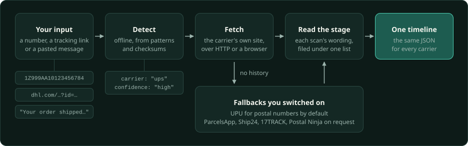

# Architecture

One lookup goes in and one timeline comes out. The package answers a question about a single
parcel and keeps nothing afterwards. Accounts, parcel storage, polling, notifications and any
decision based on an earlier check belong to whoever calls it.

## Where things live

- `core/` holds what every carrier shares: detection, the catalog, the result and status
  model, the error kinds, the step runner and the transports.
- `carriers/<id>/` is one carrier, complete.
- `providers/` holds the universal fallbacks and the rules that order them.
- `facade/` is `createTracker()`. `cli/` and `server/` are thin layers over it.
- `places/` turns the free-text location of a scan into coordinates.
- `generated/` and the catalog in `data/` come out of `npm run generate`. Edit the carrier
  folders, not those files.

## Entry points

- `universal-parcel-scraper` is safe for browsers. It exports catalog data, detection, status
  classification, input validation, result normalization and the provider-order rules, and it
  imports no Node runtime modules.
- `universal-parcel-scraper/node` adds the adapter registry, the transports, the telemetry
  hooks and `createTracker()`.
- `universal-parcel-scraper/places` loads its gazetteer on first use.
  [Its README](places/README.md) explains how a place is chosen.
- `universal-parcel-scraper/data/*` exposes the generated JSON contracts.
- `universal-parcel-scraper/app` holds helpers shaped for the parcel app this package was
  extracted from: its parcel view, the carrier-name hints for provider results, the
  result-clock helpers its sync uses, carrier scan-identity policies, what a carrier's status
  map says about a scan and the country a scan's location names. It imports no Node runtime modules and has no backward-compatibility
  guarantee; coordinate breaking changes with the app. General-purpose tracking and catalog
  helpers belong in the stable entry points, even when the app is their only consumer.

A module the browser entry points load takes text helpers from `core/transport/text.ts`, never
from the transport index, which loads Playwright and sharp. The lint rule
[`scripts/eslint-browser-imports.mjs`](scripts/eslint-browser-imports.mjs) reports the import
that reaches the index, including one that newly loads an older module.

The stable entry points and data schemas follow semver: fixes are patches, additions are
minor, and breaking changes are major. Before 1.0.0, breaking changes raise the minor version.

## Carrier folders

Each carrier owns its catalog document, retrieval, pure parsers, status evidence and
fixtures, next to a README on how its site is read. Nothing about a carrier lives
outside its folder except the files `npm run generate` derives from it.

Scope follows the service and country, not the brand alone. Separate national services keep
separate ids, and shared number shapes remain ambiguous. A group-wide endpoint matching a
number does not establish a national carrier's ownership. Catalog presence, a dedicated
adapter and successful history retrieval are separate claims in the coverage data.

A carrier's detection rules are tried in order, and the first that matches, checksum included,
sets its confidence. A narrower high-confidence rule therefore comes before a broader one; the
detection sweep fails when an earlier rule hides a high-confidence rule from every sample.
A `preferred` rule lists its carrier first among low-confidence suggestions. One that rests on
a check digit alone, its pattern a bare run of digits, gives way to a narrower preferred rule
the number also fits: FedEx's and SF Express's twelve digits to 4PX's waybills of 311.
A check digit known for one series of a format is a rule for that series, and an unchecked
rule after it takes the format's other numbers: Cainiao's `901` home-delivery numbers are
checked, its other `HD` numbers are not.

An adapter is built by a factory that receives an `AdapterEnvironment`. That environment is
its only way to the network, and no framework or app import is allowed. The registry creates
one adapter per process, on first use, so a carrier that fails to load cannot take the others
down with it.

Placeholder numbers never reach a carrier or a provider. Apart from a letter prefix and
suffix, these are six or more digits that repeat one digit or run straight up or down, such
as 123456789, or a run of nine or more with one digit after it, as a check digit would be. An
S10 item counts when its serial is one, which covers the UPU's own example. So does the
word EXAMPLE with digits around it, such as an app's demo parcel.
Many trackers keep test labels and stray scans under these numbers and show them to anyone
who asks, and providers merge them into one history. The registry's adapters,
`UniversalTracker.fetchSource()` and `amazonShippingEligibility()` refuse them before any
request: a lookup fails as `invalid_input` with reason `placeholder_number`, and recognition
answers unknown. Detection
still reads their shape, and `isPlaceholderNumber` lets a consumer refuse one at its own form.

A carrier whose `tracking.linkToken` is true takes the token of the link that opens the parcel
as its number, as an [Amazon order](carriers/amazon-order/README.md) takes its Share tracking
link's. `universalPlan()` plans no provider for it, and `UniversalTracker.fetchSource()`
refuses it as `invalid_input` with reason `link_token`: the token is a key to the parcel, not a
number a carrier prints. Clients need not show it. A number of an Amazon token's shape, a UUID
with a letter among its digits, is refused the same way when no catalog carrier is named for it,
since an integration may pass on the number `parseTrackingInput` read from the link alone.

A phone number typed as a tracking number is read with the reader's country:
`isPhoneNumber(number, country)` holds a mobile number written as it is dialled there, such as
Paraguay's 0 and nine digits from an operator's range. Only formats no carrier serving that
country issues are listed, and a number that a rule of such a carrier, or of one without a
country, accepts with its check digit is never a phone number. Recognition asks no carrier about
one for that country hint, and a consumer can hold one back at its own form. Without a country,
or for a country with no listed format, nothing is a phone number.

Shared text helpers accept strings and, for scalar codes and identifiers, finite numbers.
Provider identifiers are normalized whole before comparison; display-text limits must not
erase a different identifier's suffix. Numeric identifiers require an exact, nonnegative integer.
Adapters check required payload fields before projecting them; objects and arrays cannot
supply shipment identity, scan text or status codes.

Every adapter passes the caller's signal and budget into each request it makes. An adapter
names its client with the host's `userAgent`, never the runtime's default, and one whose
carrier only answers a browser keeps its own. `testing/adapterContext.test.ts` holds both by
driving every registered adapter and provider against a transport that never answers.
`testing/adapterContextSource.test.ts` checks that each later request and wait takes the
signal too. Lookups that need the local Chromium share one browser, and each waits its turn
inside its own budget.

Browser and image dependencies load only when the step that needs them runs. Packaged
workers, models and geographic data resolve against their own module, never the caller's
working directory.

An adapter declares its steps, for example `direct` then `trawl`.
Server-rendered tracking pages can use `trawlPageStep` after an identified browser
challenge. It opens the same whole-identifier address, rejects redirects and oversized
pages, and leaves identity and not-found checks to the carrier parser. A read the browser
service gave up for lack of time fails as `budget`. Rate limits and malformed replies do not
trigger it. In any browser step, a page the browser opened that answers 404 or 410 fails as
`transport`: the tracker is missing, not the parcel. An adapter whose carrier answers an
unknown number with such a page allows the status and reads it. HTTP recognition uses a browserless tracker instance.
[runSteps](core/runner/index.ts) runs them in order under one time budget. A later step runs
after a challenge, a transport failure or an inconclusive answer, and never after a definite
one. A step that lets its signal's deadline escape fails as `budget`. An adapter whose own read fails to reach the carrier or hangs can send it once more
through [networkRetry](core/runner/networkRetry.ts): the first try gets at most half of the
time left, so the retry fits in the budget. An HTTP status or a reply is never sent again.
A read that opts into [fetchBounded](core/transport/boundedFetch.ts)'s own retry passes the
lookup's deadline with it. A pause that would reach it is not taken: a rate limit then fails
at once with its kind and `Retry-After` window, rather than when the budget runs out.
An adapter reads a `Retry-After` header with [retryAfterMs](core/transport/retryAfter.ts):
whole seconds, or an HTTP date unless the carrier only sends seconds, with a digit cap where it
has one. An adapter whose wait has its own cap, floor or default keeps its own reading.
An adapter reads AWS WAF's action on a reply with [awsWafAction](core/transport/awsWaf.ts) and
decides itself which actions and statuses are its challenge.
A direct step that a check only a browser passes refuses, such as Correios's Turnstile page,
can rest through [DirectRest](core/runner/directRest.ts): the carrier's lookups with a browser
service then skip it for a few hours, and the next one after that asks it again. Only that
refusal starts a rest, and a tracker without a browser service, such as HTTP recognition's,
always asks directly.

Such pauses and pacing live in the process. A long-lived host that restarts often can keep them
with `keepAdapterHolds(store)` from `universal-parcel-scraper/node`
([holds](core/runner/holds.ts)): each hold is saved as it starts, with its kind, a key holding no
address or secret, and when it ends, and the holds still running are taken up at start. The
direct-step rest, USPS's outage pause and its private Chrome's rest, DPD Romania's rest from its tracker page,
Correios's read window and the numbers Cainiao had no record of for iMile are kept this way. A saved hold is never longer than its rule allows, and a
store that fails leaves the adapters as they are without one.

## A lookup

Browser route trials are opt-in. The shared transport helper assigns one alternate route
when a carrier's existing recovery starts and records route, attempt, verified connection
family and dated-history availability. It adds no attempts and does not decide which errors
are recoverable. The adapter keeps its identity checks, refusal rules and shared deadline;
the host supplies isolated services or private proxy credentials. A selected route does not
establish the connection family: only the socket does, otherwise telemetry says unknown.
A fallback route is opt-in too: USPS reads through its configured proxy only while the
carrier refuses the service's own address, and WanbExpress makes one read through its own
after a refused one. Each records its reads' routes the same way. A proxied read solves no
challenge.

A carrier that limits how often one address reads it paces its reads per egress with
`EgressPacer` (`core/transport/egress.ts`): a cap per window and a rest after a refusal. The
host may offer named egress pools in `AdapterEnvironment.egressPools`, built in Node with
`proxyEgressPool(urls, 'datacenter')`; an adapter then sends what its own address has no turn
for through the pool. Pools help only where the limit is per address. Poste Italiane uses
the `datacenter` pool.

`createTracker()` validates the input, its optional fields before recognition asks any
carrier. A number is four to forty letters and digits and normally holds a digit. Without
one it must be six to ten unbroken letters that a carrier's detection rule claims, as on a GLS notification card. Such a number is never read out of
pasted text, and the universal providers refuse it. Detection and recognition read the number
as typed, so a separator a rule needs, such as the dash in a PostLogistics reference, still
counts; adapters and providers get the normalized number. Normalization reads a letter O in an
S10 serial as a zero when the check digit then holds, since the serial holds only digits. It
drops the slashes of a NO LIMIT shipment number, which reads the same without them, and NO
LIMIT's adapter puts them back for its form. It also drops the slash MRW's receipts print after the office's five
digits; MRW's tracker knows the number without it. A Tiui folio keeps its hyphens when Tiui is
the carrier, a JRS Express reference, an airbill and its branch code, its hyphen when JRS
Express is, an IQ Fulfillment order reference the hyphen before its suffix when IQ
Fulfillment is, and a ZMC Express reference its hyphens when ZMC Express is, since their digits
alone do not give them back: `carrierTrackingNumber()` gives the
number as its carrier knows it, for consumers to store, and the same shape under another carrier
normalizes. A
postcode the carrier does not read goes to the enabled fallbacks only, since ParcelsApp and
17TRACK can ask for one. Phone digits reach only a carrier whose catalog entry asks for them,
never a fallback, and its adapter's errors never repeat them.
A number whose shape fits several carriers, or only
identifies an international postal item, is settled by asking the carriers that can recognize
it cheaply. A postal issuer is a lookup candidate, not proof of the delivery carrier.
So is a number whose issuer only universal providers track when another carrier's preferred
rule, with no check digit, fits it: Juxi Express's waybills name Juxi, and DHLink, which carries
some of them under that number, is asked.
The tracker then tries the carrier's
dedicated adapter, and after that the fallbacks the caller enabled, in the coverage order.
Detection can list `origins` beside the carrier its high-confidence rule names: carriers that
follow some parcels under that carrier's number from an earlier leg, as Cainiao follows GOFO's
GFUS waybills. While the carrier's answer holds only the label, the tracker asks them first;
movement files the parcel under the origin, and the hand-off proposes the carrier.
A direct answer marked `summary_only` or `history_truncated` asks them too. The first
fallback with more scans that names no other carrier and is not behind the carrier's state
replaces it; another network of the carrier's brand (`gofo` for `gofo-fr`) is not another
carrier, and a scan relayed twice in two wordings counts once. A checksum-valid S10 number is
one postal item for every operator that carries it, so a fallback for it may name any of them.
A clock without an offset may be any instant from 14 hours before its wall time to 12 hours
after, so a history whose newest scan is older at every reading loses. A delivered or returned
answer needs the same stage, and an earlier stage never wins, unless the history also reached
the carrier's stage, no earlier than the carrier, with only scans of an earlier rank after it,
as with a scan uploaded after the delivery; the carrier's status then stays. An exception
against another stage, or another stage of the same rank, needs a newest scan that is later
at every reading. Two exceptions can be two problems, so the provider's must be no earlier at
every reading, as when it relays the carrier's own. The winner takes the carrier's own facts
it lacks, such as the estimate, destination or weight, and `direct` keeps the carrier's answer
as it came. Otherwise, even when every fallback fails, the carrier's answer stands. Hosts that
route lookups themselves apply the same rule with `isPartialAnswer` and `fillPartialAnswer`.
A carrier whose only rows are ones it holds back as written ahead of their clocks answers
without history, with the reason `written_ahead` and their clocks in `writtenAhead`. A
fallback's rows at those clocks, the same instant within a minute or the same wall time, are
copies of them and are set aside; a fallback left with nothing has no history either. Hosts
apply `writtenAheadClocks` to the carrier's error and `withoutWrittenAhead` to each fallback.
A carrier that keeps other rows names those clocks in the result's `written_ahead`, and
`fillPartialAnswer` sets a fallback's copies of them aside before comparing histories. The
rows themselves stay in the carrier's words as `planned_events` on the result, or
`plannedEvents` on the error (`plannedEventsOf`), and a fallback that wins keeps them beside
its scans. They are steps the carrier announced, not scans: hosts may show them apart. A
provider's copies of a carrier that writes a record's whole feed as one script carry no
creation times: every one but the order's registration is set aside as the provider's answer
is read, and an answer left with nothing has no history (`written_ahead`).
An answer without history can name the hand-over in the error's `deliveryCarrier` and
`deliveryTrackingNumber`, as a result's `delivery_carrier` and `delivery_tracking_number` would:
a record can name the delivery carrier's number before any scan, or after it drops its own rows
for that carrier's. The tracker asks that partner, and when no source has a history its answer
is the result, with the partner as `source` and in `handoff`. Hosts that route lookups
themselves read the proposal with `noHistoryHandoff`.
An adapter that knows a reply field can hold a delivery estimate or slot it does not read yet
names the field in the result's `unread_estimates` (`core/result/unread.ts`) whenever a reply
fills it, so a host can keep the number for a capture that teaches the adapter its shape.
The `countryHint` input is still accepted but no longer affects a lookup.
The `language` input, the reader's language as a BCP 47 tag, goes to the carrier's adapter
(`readerLanguage`). An adapter whose tracker words its scans in that language asks in it, and
the others ignore it. Stages come from codes, not from the wording, and the carrier's identity
policy lets a scan worded in another language keep its stored row.
One deadline and one cancellation signal cover the whole call. The answer lists every
attempt with its source and outcome.

A failure's kind says what a retry can change. `invalid_input` is a number the carrier does
not issue and `schema` is a reply that was not the expected shape, so neither is worth
repeating at once.

When its sources fail differently, the lookup reports the first kind in this order that one of
them gave: `input_required`, `budget`, `rate_limited`, `challenge`, `maintenance`, `transport`,
`schema`, `indeterminate`, `not_found`, `invalid_input`. An input a source asks for is the
caller's next step, so it leads, and the hint names the `field` and, when known, the `carrier`
asking. A deadline that ended the lookup comes next, since the sources it cut short said
nothing. A source that could not answer leaves another's miss unproven, so `not_found` means
every source that could take the number said so. The hint's `retryAfterMs` is the longest wait
a source asked for while it could not answer, and each attempt keeps its own. An input the
carrier's catalog entry requires and the parcel lacks is an `InputRequiredError` before any
request.

When a result names a delivery partner, the tracker also asks that partner's adapter. Its
answer comes back separately, checked against the number on its own and finished as a direct
lookup's answer is. Adopting it is the consumer's choice. A provider's answer names one only
by a number that the own rule of its newest scan's carrier claims, as ParcelsApp's next
number for the parcel or a number Ship24 lists for that carrier. A checksum-valid
S10 item with no partner named proposes the post of the destination country its answer
reports, or for a DHL Paket parcel the partner DHL names there, if that partner looks up
DHL's number. When none is reported, a consumer may give
`deliveryHandoff` the country the parcel is looked up from, which stands in unless it issued
the item. AliExpress follows some parcels under the delivery carrier's own number and
names no partner for them. The partner is then the carrier that delivers in the destination
country Cainiao reports: the one whose high-confidence rule claims the number, unless it is an
S10 number, else the one carrier at home there whose rule fits the number beside AliExpress's.
Evri International's tracker is the reverse: it also finds a parcel by its delivery partner's
number, and that number stays the partner's. A universal provider that names the tracker for
a number another carrier's high-confidence rule claims hints that carrier, not Evri.
A sixteen-character label of three letters around one of Poste Italiane's parcel codes, as
Vinted Go and AliExpress give for parcels to Italy, proposes Poste Italiane with the code
alone, unless the answer names another partner.
When a partial carrier answer, or one without history, names the partner, the fallbacks leave
that lookup a third of the budget, at most 30 seconds. A fallback that runs out its share ends the
fallbacks, whatever the clock then reads.

A result's `service_name` is the carrier's own name for the shipping service the parcel
travels under, as its page shows it. It names the product only, never a status, the merchant
or the kind of parcel. The carriers whose `capabilities` list `service_name` fill it.

A result's `import_charges` are the duties, taxes and fees the carrier lists for importing the
parcel, in the currency's major unit: customs duty and import VAT in `customs`, the carrier's
own clearance fee in `carrier_fee`, and its lower price for paying online first in
`carrier_fee_online`, only while the carrier still takes payment online. `paid` is set only
when the carrier says; `status_code` keeps its code.
A provider's answer that lacks them takes the carrier's. The carriers whose `capabilities` list
`import_charges` fill it.

A scan's `recipient_action` says what the carrier asks the recipient to do before the parcel can
move on: `tax_id` give their tax number, such as Brazil's CPF or CNPJ, `duties` pay the import
duties or taxes, `documents` send customs documents. `normalizeCarrierResult` reads it from a short
list of whole customs wordings ([core/status/action.ts](core/status/action.ts)), so it holds for
every carrier and provider; an adapter may also set it from a code that says so, as UPS does. A
wording that mentions customs, a payment or a document without saying the recipient must act
sets nothing: a false alarm costs the reader more than a missed one. The scan's own `description`
is the carrier's request; a later scan means the carrier moved on.

Scans dated alike, to the second or by the same day alone, carry `tie_order`, their place among
them from the oldest: a carrier lists two scans of one second in the order they happened, which
their times cannot tell. `normalizeCarrierResult` reads it from the order of the answer's scans, newest first or
last as its other scans show, so an adapter that sorts scans keeps a tie in the carrier's
order, reversing an oldest-first list rather than sorting it; the shared provider result does.
An answer that dates every scan alike numbers none. A wall clock without a zone is compared only
with the answer's other wall clocks, read the same whatever the host's zone.

A result's `receiver_name`, `receiver_address`, `signed_by` and `pickup_code` hold what the
carrier shows about the recipient: the name the parcel is addressed to, the delivery address,
who signed for or took the parcel, and the code that releases it at a locker or point. Adapters
read them as the carrier gives them, masked or not. Adapters and universal providers keep a
scan's wording and place as the carrier gives them too. `hasPrivateDeliveryDetails` tells whether
they name a code, a door number or a signature, for a host that shows the history to people other
than the parcel's owner: it shows such a scan only to the owner.

A result's `pickup_point` is the point the parcel waits at for collection: its name, then its
address on the following lines. On a delivered parcel it is the point the recipient collected
it from. A parcel brought to the door has none, although some carriers still name a point
then. A parcel was collected there when its last movement before the delivery made it ready
for pickup; notices, problem reports and further delivery scans move nothing. Adapters apply
this with their carrier's own signals. Result normalization also drops the point whenever
the scans prove a door delivery: the last movement before the delivery took the parcel out
for delivery. A scan without a stage, or a history in which nothing moved, leaves the point
as the carrier gave it.

Chronopost reads its own credential-free tracking operation, including scans after export
and partner references. La Poste's unified feed can omit that history without a completeness
marker, so its fast success does not replace Chronopost's direct result: La Poste names
Chronopost as the delivery partner of an item the feed marks as Chronopost's. A checked Geopost
reference and explicit German destination propose a DPD Germany confirmation lookup.

Consumers with their own router can call `trackCarrier` from `/node` with an
`AdapterRegistry`, their configured `UniversalTracker` and a `StepRecorder`. It dispatches one
carrier lookup and leaves scheduling and provider choice to the caller. It runs the adapter as
`createTracker()` runs its direct lookup and a delivery partner's
([run.ts](core/adapter/run.ts)): a single-step adapter runs in `runSteps`, which records the
lookup, and the answer is normalized, then its planned scans are held back until due, lost
letters restored, local clocks dated, repeats read once, and late registrations and an
unstaged newest scan read as no step back. It and `UniversalTracker` hand adapters and
providers the normalized number, as `createTracker()` does: a number stored as typed, with a
letter O for a zero in an S10 serial, reaches them corrected. A caller that holds a delivery
estimate can pass it as `knownEstimate` with the `last_update` it came with: an adapter whose
estimate costs a request of its own, as
Mondial Relay's website does after its app, keeps it while its day is ahead and no newer scan
shows. An answer without an estimate says nothing about an earlier one; a carrier that states its
estimate no longer holds, without a new one, marks the answer `expected_delivery_withdrawn`. An adapter with `recordsSteps` reports its own lookup, so dispatch
does not wrap its telemetry a second time. The errors a `StepRecorder` receives keep what
explains a failure, the tracking number, postcode or phone digits in a query or body included,
and no credential where a serializer finds it: `UpstreamHttpError` and `UpstreamNetworkError`
redact credential headers, an address's user info and fragment, and the query parameters and
JSON, form or XML body fields named after credentials or guest verification proofs. Structured
proxy fields and incomplete JSON bodies are redacted in full. A reply's body excerpt is read by name only. `CarrierError.reason` separates expected details,
such as Amazon Shipping's expired history, from transport failures. A record's error type is the
error's class name; a plain `CarrierError`, which an adapter builds to keep a failure's kind without
its cause, gives the class its kind stands for. An inconclusive error
for the carrier's own answer that it holds no history under the number, an empty result or
not-found notice, carries `portal_not_found`, so a consumer can tell that answer from an
outage; it does not make the parcel absent. `UNKNOWN_ITEM_REASONS` lists it with the other
reasons for such an answer. An answer without history from a carrier that lists
the shipment but holds no scan for it, as for one booked, announced or labelled, carries
`listed`: the carrier knows the number. A rate limit an adapter's own pacing imposes,
refused before any request, carries `self_paced`: the lookup sent nothing, so a consumer can
treat it as a deferral rather than the carrier's throttling. Invalid input carries `other_carrier` when the carrier's answer
names another carrier as the shipment's, so a consumer does not read it as a mistyped number.
Invalid input carries `wrong_number` when the carrier's answer says the number is wrong, such as
R+L's failed check digit or a format its tracker refuses, so a consumer can ask for the number
to be checked; a refusal of a postcode, a link or another detail carries none. An adapter
refuses a number of a shape it does not take before its lookup starts, with no reason.
A challenge names the stage that stopped it when
the adapter can tell: `api_denied` when the carrier refused the request outright,
`puzzle_missing` when no puzzle appeared, `puzzle_unsolved` or `solver_unavailable` when the
solver gave no answer, `verification_refused` when the answer was refused, and
`verification_unfinished` when time ran out before verification and tracking finished.
A transport failure carries `capture_missing` when a browser lookup submitted the carrier's
form and its reply never came back.

USPS barcode validation shares the carrier adapter's whole-identifier checks. A routing
barcode is `420`, the recipient's five- or nine-digit ZIP code and a 22- or 26-digit package
identifier, so 30 and 38 digits split one way and 34 digits two ways. The prefix is removed
when only one reading passes the check digit, or when both 34-digit readings pass and only
one has a Mailer ID that fits its channel. Otherwise the barcode has no identifier. Result
normalization applies the same rule to every number a result reports, so the delivery,
canonical and international numbers never carry the recipient's ZIP code: a routing barcode
keeps its package identifier or is dropped. Universal providers are asked for that package
identifier. A number of that shape without one is never sent to them, as typed or as either
reading: each provider step is inconclusive, `indeterminate` with reason
`usps_routing_barcode`, before any request. The USPS and DHL eCommerce adapters also ask for
the package identifier and reject a barcode without one as invalid input, so the lookup ends
inconclusive without a request. A 22-digit PIC whose channel, Mailer ID
and check digit agree selects USPS, apart from the families DHL eCommerce also tracks. A
routing barcode built on such a PIC selects USPS too, unless its ZIP+4 add-on starts with
92 to 94 and could open a 26-digit PIC instead. Other checksum-valid USPS formats prioritize
a candidate and still require carrier confirmation; for routing barcodes those are the 30-
and 34-digit forms Publication 199 defines. Detection and recognition read a routing barcode
as typed: outside that PIC rule, a bare identifier also fits other carriers' formats.

Recognition uses HTTP by default. Consumers can request `recognitionCandidates` with
`phase: 'browser'` after HTTP is inconclusive, then call the adapter's
`recognizeWithBrowser` under a separate budget. The catalog declares eligibility and rank, and
can name the numbers a browser lookup is worth, as DPD France's layouts;
recipient inputs exclude a candidate. A carrier that holds the parcel but shows it only with
the recipient's input knows the number: the adapter's `input_required` error carries the
reason `parcel_found`, and recognition answers known without an activity date. So it does for
an answer without history that shows the carrier holds a record of the number: `listed`,
`parcel_found` or `written_ahead`, or a record naming the delivery carrier or planned steps. An
answer with a reason of `UNKNOWN_ITEM_REASONS` is the carrier's answer that it shows no parcel
under the number: recognition answers unknown, as for a not-found. A no-history answer without a
reason fails, since adapters also give it for a record without rows. An adapter marks an answer
that settles nothing for it as `inconclusive`, and recognition fails on it: one its browser
confirmation reads further, as DHL Express's blank checkpoint and a package DHL eCommerce's
Webtrack lists without history, or a miss from a search that does not find every parcel by the
number asked, as DHLink's for a DHLink number. A carrier whose HTTP recognition cannot bind every number
its rules offer names the ones it can, and is only suggested for the rest: Saia's service never
sees a PRO's twelfth digit. Browser confirmation requires dated shipment activity, or the
carrier's word that it holds a record of the number, and returns the tracking result of dated
activity for reuse. Through an `AdapterRegistry`, that result is finished
for the carrier asked as `trackCarrier` finishes a lookup; an adapter's own `track()` answer is
not, and goes through `trackCarrier` or `createTracker()`. An ambiguous ten-digit number includes DHL Express among its direct candidates when its waybill check passes. Its
facility clocks are dated where the scan's location settles a zone and stay unresolved
elsewhere; Ship24 relays them with DHL's own offsets.
DHL Express's HTTP path uses its mobile guest API and includes the shared
application bearer. Application settings and authentication failures stay distinct
from a missing waybill; verification failures can recover through its public browser page.
Consumers can ask enabled universal providers during preflight and reuse those results
when saving, while retaining direct confirmation for carrier identity.
Shared tracking portals marked `detectFromNumber` preserve ambiguity when the
number suggests several divisions served by the URL, or prefers another division with
links on that host. When that division is the only one of the number's carriers with
links on the host, and has one for the page, the link names it. A country-specific portal
can still identify its own operation. A link marked `ownNumbersOnly` names its carrier
only for a number that carrier's detection rules offer; any other number it holds
is detected on its own. A link printed without its scheme, as text messages give
them, is read as a link only on a host a link rule names.
A shop's own tracking page, run by a platform such as parcelLab
(`<shop>.delivery-status.com`), Narvar, AfterShip, Sendcloud or ParcelPanel, is no carrier's
link. `shopTrackingLinks` finds such links in a text or an HTML email and
`resolveShopTrackingLink` reads each parcel's number and carrier from the link, or, for a
parcelLab link that carries only an order and its hash, from parcelLab's anonymous API, with
the shop's account read from its page or from a script the page loads from its own host. The
courier's own tracking link names the carrier when the catalog reads the same number from it,
then the platform's courier code unless the number is surely another carrier's, then the
number. A link that names no parcel says why: not found or expired, no number yet, refused,
rate-limited, unavailable or unsupported, as the other platforms' order links are: they need
the buyer's e-mail or postcode. Shopify's order-status links are not read: their key allows
only a few visits and Shopify's shipping email links the carrier anyway. The resolver keeps
no name or address. Links that carry their number also go through `parseTrackingInput`, with
the carrier left to the number.
A shipping email's tracking button often opens a mailing tool's click redirect instead (Emarsys'
`nrd.php`, SendGrid's `ls/click` and `ss/c`, Mailchimp's `list-manage.com`, Klaviyo's
`klclick`, Salesforce Marketing Cloud's `?qs=`, Amazon SES' `awstrack.me`, Shopify's `/_t/c/`,
the `/lnk/` links that end with their address in base64, as DHL eCommerce's notifications do).
Every link of such an email, unsubscribing included, goes through it, so `shopTrackingLink`
takes one only with the link's words, its text or the words written before it, when they read
like tracking and neither they nor the address read like unsubscribing; words that also follow
a shop on social networks or offer free shipping don't count. The resolver follows its
redirects with no cookie, referrer or body read, for at most four requests, and stops at the
first address that is no mailing tool's without loading it: a carrier's link names its parcel by
the link rules, a shop platform's link is resolved as above, any other page is unsupported.
Amazon SES and the `/lnk/` links write the address into the link, which is read with no request. Following a
redirect counts as the reader's click in the shop's mailing statistics. A browser's fetch
hides where a redirect leads, so these links stay unresolved there.
Consumers bound concurrency, cache answers and
decide when another check is due. `recognizeAll` passes cancellation and its budget to each
callback and discards late answers. A failed outcome that threw a carrier error carries its kind
and reason as `failure`: a reason of `UNKNOWN_ITEM_REASONS` is the carrier's own empty answer that
its adapter marked inconclusive, which leaves the carrier offered by its rule; a check without
`failure` threw no carrier error or did not answer in time.
Pass the earlier HTTP error as the browser method's third argument so the adapter retains
its recovery policy, including rate limits and malformed responses.

Callers can order eligible recognition candidates with a `countryHint` and aggregate
`priorities`. A provider's carrier hint and preferred number evidence come first, followed
by the country (home before other served countries), aggregate scores, a passing check digit
and catalog rank. These signals do not add candidates or confirm ownership. A carrier whose
`recognition` sets `servedCountriesOnly` prints bare runs of digits that carriers elsewhere
print too, so for such a run, when the country hint is none it serves or there is none, it is a
candidate outside the country (`outsideCountry`). A low-confidence rule can set
`servedCountriesOnly` for a shape printed elsewhere too, such as a shop's own number: a carrier
only such rules offer the number is outside the country when the hint names one it does not
serve. A low-confidence rule can set `lastResort` for a shape too weak to ask its carrier
beside the others, wherever the lookup comes from, such as a range another carrier's numbers
fill: TNT France's sixteen digits from 17 or 18 sit among Vinted Go's. A candidate outside the
country, or one only `lastResort` rules offer the number, is a last resort (`lastResort`): last
resorts come after all others, whatever the hint, and are asked only once every other candidate
has missed the number, never beside them, as a carrier knowing another carrier's number for a
parcel of its own stays unlikely to settle it.
`recognitionAskedCarriers` is the first `MAX_RECOGNITIONS` of that order, last resorts apart.
`createTracker()` asks those first, the next `MAX_RECOGNITIONS` only while none asked so far
knows the number and the budget lasts, and last resorts in rounds of their own after them.
`settleRecognition` sets aside an answer quiet for 60 days, taken for an older parcel that
reused the number, and a delivered or returned one (`finished`) quiet for 30: a run of digits
many carriers print finds a stranger's finished parcel. An answer without an instant is dated
by its local clock (`lastActivityLocal`); one without any clock counts only when no dated answer is recent.
It takes the only carrier that knows the number. When AliExpress and a
delivery carrier both know it, the number is the delivery carrier's and AliExpress started
the journey, so it takes AliExpress. Otherwise it takes the only one number evidence backs,
unless that evidence is a check digit alone, its rule a bare run of digits, and another
carrier that knows the number passes a check digit of its own (the candidate lists them as
`checkDigitPeers`): DHL Express's waybills and ACS's vouchers share theirs. When all that know it are one brand's networks, it takes one that tracks without the user's
input, then the one serving the country hint (each candidate carries the match as
`countryMatch`), then the highest rank. Other unrelated carriers stay a choice. While a
carrier number evidence backs has failed without saying it holds nothing under the number
(`not_found`, `invalid_input`, `input_required` or a reason of `UNKNOWN_ITEM_REASONS`), and answered no other
ask, neither the only answer nor a brand's pick is taken when the evidence leaves it out and
it is not among the backed carrier's `checkDigitPeers`: the parcel may be the backed carrier's.
`recognitionNumberShape` retains only character classes and run lengths for private
aggregate analysis. Keep direct-confirmed live inputs outside Git; repeated observations
of one number do not establish independent evidence.

Some checksums are inferred from public samples. `checksumRejections` names, by their
`carrier.json` ids, the rules whose pattern fit a number but whose checksum failed when
that kept their carrier out of the suggestions. A consumer that later confirms one of those
carriers for the number can count the carrier and rule, without the number, to find a
check that real numbers fail. Where the carrier's adapter applies the same check before any
request, that confirmation cannot happen, so a provider naming that carrier for the number
does not propose it, even when another carrier's high-confidence match kept a low-confidence
rule out of `checksumRejections`. FedEx's adapter does not apply its 12-digit check, but
every public FedEx number passes it and providers name FedEx for DHL Paket numbers that fail
it, so such a name does not propose FedEx either.

After building, `node scripts/analyze-recognition.mjs --input <private.jsonl>
--output <private-priorities.json>` reads rows containing `number`, `carrier` and
`confirmation: "direct"`. It discards conflicting labels, reports independent holdout
coverage and emits scores only for shapes with at least twenty distinct confirmations
and carriers with at least five. Its output contains no numbers or prefixes. Consumers
own this evidence and decide when to reload it; it does not alter detection rules.

## Status model

Every scan ends up with one stage from [stages.json](data/stages.json), and `stage_source`
says how it got there:

- A stage the adapter declared from the carrier's own codes wins.
- A scan without one goes through the shared wording classifier in
  [core/status](core/status/wording.ts).
- A scan no rule matches takes the caller's fallback.

Adapters retain `stage_source` when they classify wording before returning a stage.
Explicit carrier vocabularies and provider codes use `carrier_map`; text rules use
`wording:<rule>`, and unmatched text uses `none`. Resolution preserves that source,
including on `pending` events. A scan the adapter left without a stage gets the classifier's
source too, and `stage_inferred: true`, so a consumer can tell the scraper's guess from the
adapter's own wording rule. Universal summaries carry `current_stage_source` from
the event that establishes the current stage. Consumers can review wording and
fallback decisions without mistaking them for explicit maps. `resultStage()` reads a result
that states no status by its newest scan with a stage, unless that scan is a delivery or a
return the newer scans without a stage may have undone. Every adapter's answer reads the same
way when it states neither status nor stage, as one whose status comes from a newest scan its
map does not know: one new code does not blank the parcel, and that scan keeps no stage, so
its wording stays open for review ([unstaged.ts](core/result/unstaged.ts)). An adapter that
reads the stage from its own scans and lets a newer scan without a stage undo a delivery or a
return takes it with `leadingScan()`: a notice its map says moves nothing, mapped to `pending`
or left without a stage on purpose, is passed over, so a delivery stands under it.

A registration (a label created, data received, a pre-advice) dated after a scan that moved
the parcel is no step back: a partner's label or a line's order row is often written once the
parcel is on its way. Every adapter's and provider's result reads it as in transit, even right
after an acceptance, since a label is not one, with the source `carrier_map`. One dated first,
or within a minute after the first movement, stays registered: a provider's copy dated seconds
after the scan it came with is that scan's record ([registration.ts](core/result/registration.ts)).
One that repeats a registration from before the movement word for word, under the same code, is
that registration told again: a notice on the stage the parcel had, with the source `none`.
Scans are compared by their instants, or by wall clocks in a history with no instant. A customs
filing, a problem or a scan no rule read is not a movement. A result whose current stage is
registered for its newest scan, a registration after a movement, is in transit, or accepted when
that registration is the record of the acceptances that are the parcel's only movements.
A provider's history joins several networks' legs, each wording its own receipt as an acceptance.
Past the first movement's minute, an acceptance a provider's wording rules read is a hand-over on
the way, in transit; one a carrier's map reads keeps its stage ([acceptance.ts](providers/shared/acceptance.ts)).

A step a carrier records again within minutes is read once: every adapter's and provider's
result leaves out a scan with an earlier scan's wording, place and stage at most ten minutes
after it, as a gateway that scans one departure several times writes, unless a scan of another
stage came between them ([repeats.ts](core/result/repeats.ts)). The first record stays, so a
stored scan keeps its identity as the carrier adds copies. Before that, a universal provider's
answer that lists one scan twice in one minute, from two of the networks it reads, once to the
minute and once to the second, keeps the copy to the second (`withoutMinuteCopies`): the same
wording apart from case and spacing, the same stage, places that agree or one left out, and a
match unique both ways. The copy keeps its place, or takes the other's when it gives none.
Answers of different providers are not merged. The app exports the rule, so stored rows of one
provider can be read with it again.

Each carrier's `statuses.json` records the codes and wordings seen from that carrier and the
stage each one means. [CORPUS.md](CORPUS.md) describes those records.

An adapter prefers the carrier's own English, through its locale or an English endpoint. A
carrier with none can show an entry's `english` in place of a wording it gives only in another
language ([english.ts](core/status/english.ts)): the stage still comes from the carrier's
wording, the map answers both, and `translatedScanPolicy()` lets the English scan take over the
row the app stored in the carrier's wording. A wording without known English keeps it.

A common scan can also name a template whose text every language the app shows has
([templates.ts](core/status/templates.ts)). `scanTemplate()` in the app entry gives a scan's
template and the language of the carrier's wording, by provider code and then wording, from the
entries of the carrier's `statuses.json` that name one, so the app shows the template to a reader
of another language and the carrier's own words to the rest. The texts are in
[data/scan-templates.json](data/scan-templates.json), which the apps bundle.

A carrier can declare a `statusMap` next to its map in `status.ts`: the stage its map gives
one provider code and wording, and the codes and wordings it leaves without a stage on
purpose, each with a note. A scan of the carrier's own that moves nothing, such as a note on
the record or a request, is mapped to `pending` rather than left without a stage: a consumer
reads a scan without one by its wording or as in transit. [statusMaps.ts](core/catalog/statusMaps.ts) registers them by
adapter, so Delivengo reads La Poste's. `statusMapAnswer()` in the app entry asks them the
way the app keys the wording it reviews: carrier, provider code, and the wording in
`normalizeStatusWording()` form. It answers `mapped` with the stage, `intentional_gap` with
the note, or `unknown`. A gap without a code covers only wording that came without one, a
gap without wording covers every wording of its code, and the map's `gapNote` names the gaps
it cannot list one by one, such as notices that carry a date. The answer reads the code and
wording alone: a stage that depends on the rest of the reply, such as a DPD scan staged by
its enumeration twin, is `unknown`, and so is every scan of a carrier without a declaration.
The app files the scans a universal provider relays under the carrier `unknown`. Their map is
the reading the providers give a scan ([providers/status.ts](providers/status.ts)): a 17TRACK
sub-status where it outranks the wording, else the wording rules every provider applies,
which put their own vocabulary around the shared language rules. A scan neither its code
nor a rule stages is `unknown`, except notices that are no scan, such as Chronopost's notice
to the recipient or SEUR's delay, which are left out on purpose, and a leg 17TRACK files under a
return's code, whose stage depends on the answer, which is a gap. After a release the app can ask it about every open review entry and close
those the map now stages or leaves out on purpose, under the version it runs.
A provider that names the service behind each scan, as Postal Ninja does (`reporting_carrier`),
stages the scan by that carrier's map when the map declares that it reads wording without a code
whole (`wholeWording`), with the source `carrier_map` (`relayedWordingStage()`). A map that reads
such wording by keywords is left out: a relayed sentence can carry its words in another sense.
The `unknown` map cannot tell those scans apart, so it can read them otherwise.
A carrier whose own answer reads the scans after a return began as the trip back, as USPS's
does, declares it on its map (`returnTrip`). A provider's answer for that carrier then reads
the scans from the oldest one the map reads as the return the same way, with the source
`carrier_map` ([returnTrip.ts](providers/shared/returnTrip.ts)).
A word one carrier uses in a sense of its own, which the shared rules leave open or read
otherwise, is a scoped rule ([core/status/scoped.ts](core/status/scoped.ts)): the carrier, the
providers whose copies it reads when only some relay the word so, the whole wording and the
stage. A provider's scan belongs to the carrier it names (`reporting_carrier`), else to the
parcel's carrier (`discovered_carrier`) when the provider names no other. The rule outranks the
shared rules, never a carrier's map, and gives the source `wording:provider`. Everywhere else,
the `unknown` map included, the word keeps the shared reading.

Some carrier categories cover several milestones. Exact carrier labels refine those cases;
explanatory reasons and future delivery instructions do not establish a new milestone.
A delivery still to come (a forecast, a notice, an instruction or a duty-payment condition:
"will be delivered", "sera livré", "wird morgen zugestellt", "sarà consegnato", "será entregado")
is no scan. The classifier reads only the rest of the sentence, so a notice alone takes the
caller's fallback with `none` and never steps a parcel back to registered. A row a tracker
wrote well before its own clock, as forwarders that write a whole timeline when an order is
created do, is a forecast too, and the adapter leaves it out, along with a fallback's copies
of it when nothing else remains. A carrier that enters some scans at their planned time, such
as a departure at its schedule, has an adapter with `plannedScans`: its scans dated more than
five minutes after the lookup are held back until they are due. Other scans dated ahead keep
their time for the host to flag.
Customs that cleared or released a parcel puts it back in transit; holds, inspections,
submissions and a clearance still to come or negated stay `customs`. An export clearance or
declaration started or under way is a routine step before the flight and reads `in_transit`,
unless customs holds, inspects or detains the parcel there. A customs problem is an
`exception`.
Universal providers preserve Posti's handling labels, where registration can record repeated
physical handling rather than electronic pre-advice.

A culture's short date can drop the leading zero of a day, month or hour, which samples
dated from the 10th, in October to December or from 10:00 hide. A parser pads such a field
with `paddedDate()` ([fields](core/time/fields.ts)) before matching it against two digits,
and `zonedTime()` reads `dd`, `MM`, `HH` and `hh` with one digit or two.

`resolveResult()` exposes an `instant` only for a scan clock with a verified UTC offset.
Local clocks keep their original fields. An adapter puts a clock whose zone the feed does
not establish in `local_time`: a consumer reads an offset-less `time` in the result's zone,
else in the carrier's catalog zone. A wall time the clocks repeat when they go back reads as
its first occurrence in every season: Luxon would pick by the season the code runs in, so a
parser reads a wall clock in a zone through `firstOccurrence()`, which lint enforces, unless
it keeps that hour in `local_time`. Node lookups (`trackCarrier()`, `createTracker()` and its
delivery partner's) then date such a scan on a deduced zone with `dateLocalClocks()`
([places](places/README.md#clocks)): its place, the leg the parcel was on, the destination
the carrier delivers in, else the carrier's home clock. The scan keeps `local_time` and gains
`time_zone` and
`time_zone_basis`, so a consumer can tell a deduced instant from one the carrier stated. A
universal provider's copy that its adapter read on a zone, the provider stating none, names the
zone and basis beside its instant too, with `label` for a provider's UTC label it kept because
nothing placed the scan. A zone
that would date a scan more than a few minutes after the read is not its clock, so the scan
keeps its wall clock alone. A scan dated by its day alone keeps that day. A universal
provider's result lists it above the newest scan of its day at an earlier stage, else below the
day's timed scans, and a consumer
dating it by its neighbours follows that order. A carrier that gives such scans no clock by design,
as BRT does a delivery round or a portal that lists its history under day headings, sets
`tracking.dateOnlyScans`: a consumer need not ask fallback providers for a clock no copy has. A
carrier whose scans usually carry a clock and only sometimes lack one leaves it unset, and leaves
`tracking.localClocks` unset too when its other scans are instants, so a consumer does not hold
its answer back for a dated copy. A carrier whose page states every scan on one clock of its own,
as Landmark Global's does US Central time wherever the scan was, sets `tracking.pageClock`: the
instant stands, but a consumer reads the scan's day on its place's clock. A
zone the carrier states, or one learned for it from copies that carry an instant, belongs in
its adapter. More rows alone do not prove a fresher or more complete history.

The app's scan-identity policies, one per source in `core/catalog/eventIdentity.ts`, say
what identifies a stored scan that its source now reports at the same instant with a
location, without one it no longer reads as a place (a service's name, a status, Posti's
"abroad", Austrian Post's `PLZ` delivery area), with a corrected stage or with new
wording: an unchanged instant, wording and known stage, the provider code, or a comparison
specific to the carrier. Matches must be unique in both directions, and distinct wording
can distinguish scans sharing an instant. Conflicting locations stay separate, and older
apps that cannot compare scan evidence only use the policies that need no comparison. A
policy's `relabelledFrom` names the zone a source once put on every wall clock: a scan
whose wall clock now carries another offset takes over the row stored under the old label,
by provider code and location. A policy's `matchWallClock` serves a source whose feeds put
different offsets on one scan's wall clock: a scan takes over the row showing its wall clock
under another offset, by location and wording. Every carrier flagged `tracking.localClocks`
has it, so a scan a release dates on a better deduced zone takes over its stored row; one
with no policy of its own gets one that matches only that way or by the same wording and
location at the same instant. A policy's `matchWithinMinute` serves a source whose feeds
date one scan apart, one to the minute and one to the second, in their own wording: a scan
takes over a row less than a minute away that the policy's comparison accepts, as DPD
Germany's app service and guest API do, or Chronopost's service and the La Poste feed
earlier releases read it from. A policy's `redatedScans` names the scans a source re-dates
later, after listing them, and then lists only at their new time, and how much later: USPS's
facility departures, up to a day on. A universal provider's scan has no code to
relabel by: the app leaves it out as a copy of its stored row when its instant moved by whole
quarter hours, up to 14 hours, with the same wording, and that row keeps the old instant
until a re-key.

## Fallback providers

The universal providers answer when no dedicated adapter can, and can complete a dedicated
adapter's partial answer. Commercial ones run only when the caller names them, and UPU is the
default. `universalPlan()` picks and orders the eligible providers: by recorded evidence and
the consumer's own counts first, then HTTP before a browser when someone may be waiting, then
by a draw on the number that spreads the lookups over providers of equal coverage.
[providers/COMPARISON.md](providers/COMPARISON.md) explains the order and
[providers/COVERAGE.md](providers/COVERAGE.md) holds the evidence. A number of seven
characters or fewer reaches them only with its carrier: a provider that guesses the carrier
of a number that short can answer with another shipment at each lookup. Most guess even when
given the carrier, so an answer stands only when it names that carrier or another network of
its brand, or names the partner it hands the parcel to beside the carrier's own leg.

A provider can relay a timeline a carrier wrote to a schedule. Rows a fixed time apart, each
within a second of the one before, four or more, are no scans and are dropped. The step is an
hour or more and not a whole number of hours, which one scan read on several clocks, or a row
written at the same time each day, would be. Rows all on whole minutes stay. A provider left
with nothing has no history, with the reason `written_ahead`.

## HTTP server

The server adds bounded in-memory caching, duplicate-request sharing, provider spacing,
request limits and optional bearer authentication. It has no database.

Requests share a lookup, and its cached answer, when the tracker reads their inputs alike. A
missing field and a blank one are the same, values are trimmed where the tracker trims them,
and a postcode's country counts only beside a postcode. The deprecated `countryHint` is
checked but changes no lookup. Expired entries are swept at most once a minute.

A failed lookup is held too, for at least `failureCacheMs` and longer when the upstream or
the carrier's own after-failure interval asks for it. `Retry-After` says when the server will
ask again. A lookup that needs an input answers 400 with its `field`, and the `carrier` when
known, without `Retry-After`: the request has to change first. A failure on a caller's own
`budgetMs` is never held, nor is an answer whose sources that budget cut short. Only requests
on the same budget share a lookup in progress. A client that leaves stops waiting and is
logged with status 499. The last one to leave cancels the lookup, which frees its slot and is
never held. `maxConcurrent` counts recognitions and tracking lookups together. Limits count
the socket address unless `trustedProxies` says how many proxies append to `X-Forwarded-For`.

Its logs carry route names, status codes and durations only. Library consumers connect their
own observability through `StepRecorder`. The routes are in [openapi.json](server/openapi.json).

FedEx's opt-in residential retry worker uses the same browser flow and bounded second attempt as the primary service. A configured gateway is never treated as evidence of the exit's IP family; page and API proxy tunnels are required. Byte telemetry measures encrypted proxy payload, including page dependencies, rather than billing totals.
