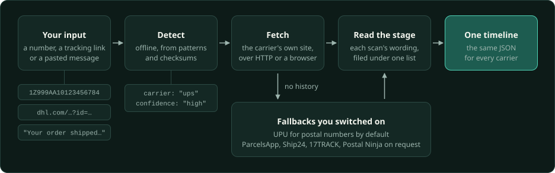

# Architecture

One lookup goes in and one timeline comes out. The package answers a question about a single
parcel and keeps nothing afterwards. Accounts, parcel storage, polling, notifications and any
decision based on an earlier check belong to whoever calls it.

## Where things live

- `core/` holds what every carrier shares: detection, the catalog, the result and status
  model, the error kinds, the step runner and the transports.
- `carriers/<id>/` is one carrier, complete.
- `providers/` holds the universal fallbacks and the rules that order them.
- `facade/` is `createTracker()`. `cli/` and `server/` are thin layers over it.
- `places/` turns the free-text location of a scan into coordinates.
- `generated/` and the catalog in `data/` come out of `npm run generate`. Edit the carrier
  folders, not those files.

## Entry points

- `universal-parcel-scraper` is safe for browsers. It exports catalog data, detection, status
  classification, input validation, result normalization and the provider-order rules, and it
  imports no Node runtime modules.
- `universal-parcel-scraper/node` adds the adapter registry, the transports, the telemetry
  hooks and `createTracker()`.
- `universal-parcel-scraper/places` loads its gazetteer on first use.
  [Its README](places/README.md) explains how a place is chosen.
- `universal-parcel-scraper/data/*` exposes the generated JSON contracts.
- `universal-parcel-scraper/app` holds helpers shaped for the parcel app this package was
  extracted from: its parcel view, the carrier-name hints for provider results, the
  result-clock helpers its sync uses, carrier scan-identity policies, what a carrier's status
  map says about a scan and the country a scan's location names. It imports no Node runtime modules and has no backward-compatibility
  guarantee; coordinate breaking changes with the app. General-purpose tracking and catalog
  helpers belong in the stable entry points, even when the app is their only consumer.

A module the browser entry points load takes text helpers from `core/transport/text.ts`, never
from the transport index, which loads Playwright and sharp. The lint rule
[`scripts/eslint-browser-imports.mjs`](scripts/eslint-browser-imports.mjs) reports the import
that reaches the index, including one that newly loads an older module.

The stable entry points and data schemas follow semver: fixes are patches, additions are
minor, and breaking changes are major. Before 1.0.0, breaking changes raise the minor version.

## Carrier folders

Each carrier owns its catalog document, retrieval, pure parsers, status evidence and
synthetic fixtures, next to a README on how its site is read. Nothing about a carrier lives
outside its folder except the files `npm run generate` derives from it.

Scope follows the service and country, not the brand alone. Separate national services keep
separate ids, and shared number shapes remain ambiguous. A group-wide endpoint matching a
number does not establish a national carrier's ownership. Catalog presence, a dedicated
adapter and successful history retrieval are separate claims in the coverage data.

A carrier's detection rules are tried in order, and the first that matches, checksum included,
sets its confidence. A narrower high-confidence rule therefore comes before a broader one; the
detection sweep fails when an earlier rule hides a high-confidence rule from every sample.

An adapter is built by a factory that receives an `AdapterEnvironment`. That environment is
its only way to the network, and no framework or app import is allowed. The registry creates
one adapter per process, on first use, so a carrier that fails to load cannot take the others
down with it.

Placeholder numbers never reach a carrier or a provider. Apart from a letter prefix and
suffix, these are six or more digits that repeat one digit or run straight up or down, such
as 123456789, or a run of nine or more with one digit after it, as a check digit would be. An
S10 item counts when its serial is one, which covers the UPU's own example. So does the
word EXAMPLE with digits around it, such as an app's demo parcel.
Many trackers keep test labels and stray scans under these numbers and show them to anyone
who asks, and providers merge them into one history. The registry's adapters,
`UniversalTracker.fetchSource()` and `amazonShippingEligibility()` refuse them before any
request: a lookup fails as `invalid_input` with reason `placeholder_number`, and recognition
answers unknown. Detection
still reads their shape, and `isPlaceholderNumber` lets a consumer refuse one at its own form.

A phone number typed as a tracking number is read with the reader's country:
`isPhoneNumber(number, country)` holds a mobile number written as it is dialled there, such as
Paraguay's 0 and nine digits from an operator's range. Only formats no carrier serving that
country issues are listed, and a number that a rule of such a carrier, or of one without a
country, accepts with its check digit is never a phone number. Recognition asks no carrier about
one for that country hint, and a consumer can hold one back at its own form. Without a country,
or for a country with no listed format, nothing is a phone number.

Shared text helpers accept strings and, for scalar codes and identifiers, finite numbers.
Provider identifiers are normalized whole before comparison; display-text limits must not
erase a different identifier's suffix. Numeric identifiers require an exact, nonnegative integer.
Adapters check required payload fields before projecting them; objects and arrays cannot
supply shipment identity, scan text or status codes.

Every adapter passes the caller's signal and budget into each request it makes. An adapter
names its client with the host's `userAgent`, never the runtime's default, and one whose
carrier only answers a browser keeps its own. `testing/adapterContext.test.ts` holds both by
driving every registered adapter and provider against a transport that never answers.
`testing/adapterContextSource.test.ts` checks that each later request and wait takes the
signal too. Lookups that need the local Chromium share one browser, and each waits its turn
inside its own budget.

Browser and image dependencies load only when the step that needs them runs. Packaged
workers, models and geographic data resolve against their own module, never the caller's
working directory.

An adapter declares its steps, for example `direct` then `trawl`.
[runSteps](core/runner/index.ts) runs them in order under one time budget. A later step runs
after a challenge, a transport failure or an inconclusive answer, and never after a definite
one. An adapter whose own read fails to reach the carrier or hangs can send it once more
through [networkRetry](core/runner/networkRetry.ts): the first try gets at most half of the
time left, so the retry fits in the budget. An HTTP status or a reply is never sent again.

## A lookup

`createTracker()` validates the input. A number is four to forty letters and digits and
normally holds a digit. Without one it must be six to ten unbroken letters that a carrier's
detection rule claims, as on a GLS notification card. Such a number is never read out of
pasted text, and the universal providers refuse it. Detection and recognition read the number
as typed, so a separator a rule needs, such as the dash in a PostLogistics reference, still
counts; adapters and providers get the normalized number. Normalization reads a letter O in an
S10 serial as a zero when the check digit then holds, since the serial holds only digits. It
drops the slashes of a NO LIMIT shipment number, which reads the same without them, and NO
LIMIT's adapter puts them back for its form. A
postcode the carrier does not read goes to the enabled fallbacks only, since ParcelsApp and
17TRACK can ask for one.
A number whose shape fits several carriers, or only
identifies an international postal item, is settled by asking the carriers that can recognize
it cheaply. A postal issuer is a lookup candidate, not proof of the delivery carrier.
The tracker then tries the carrier's
dedicated adapter, and after that the fallbacks the caller enabled, in the coverage order.
A direct answer marked `summary_only` or `history_truncated` asks them too. The first
fallback with more scans that names no other carrier and is not behind the carrier's state
replaces it; another network of the carrier's brand (`gofo` for `gofo-fr`) is not another
carrier, and a scan relayed twice in two wordings counts once. A checksum-valid S10 number is
one postal item for every operator that carries it, so a fallback for it may name any of them.
A clock without an offset may be any instant from 14 hours before its wall time to 12 hours
after, so a history whose newest scan is older at every reading loses. A delivered or returned
answer needs the same stage, and an earlier stage never wins, unless the history also reached
the carrier's stage, no earlier than the carrier, with only scans of an earlier rank after it,
as with a scan uploaded after the delivery; the carrier's status then stays. An exception
against another stage, or another stage of the same rank, needs a newest scan that is later
at every reading. Two exceptions can be two problems, so the provider's must be no earlier at
every reading, as when it relays the carrier's own. The winner takes the carrier's own facts
it lacks, such as the estimate, destination or weight, and `direct` keeps the carrier's answer
as it came. Otherwise, even when every fallback fails, the carrier's answer stands. Hosts that
route lookups themselves apply the same rule with `isPartialAnswer` and `fillPartialAnswer`.
A carrier whose only rows are ones it holds back as written ahead of their clocks answers
without history, with the reason `written_ahead` and their clocks in `writtenAhead`. A
fallback's rows at those clocks, the same instant within a minute or the same wall time, are
copies of them and are set aside; a fallback left with nothing has no history either. Hosts
apply `writtenAheadClocks` to the carrier's error and `withoutWrittenAhead` to each fallback.
The `countryHint` input is still accepted but no longer affects a lookup.
The `language` input, the reader's language as a BCP 47 tag, goes to the carrier's adapter
(`readerLanguage`). An adapter whose tracker words its scans in that language asks in it, and
the others ignore it. Stages come from codes, not from the wording, and the carrier's identity
policy lets a scan worded in another language keep its stored row.
One deadline and one cancellation signal cover the whole call. The answer lists every
attempt with its source and outcome.

A failure's kind says what a retry can change. `invalid_input` is a number the carrier does
not issue and `schema` is a reply that was not the expected shape, so neither is worth
repeating at once.

When a result names a delivery partner, the tracker also asks that partner's adapter. Its
answer comes back separately, checked against the number on its own. Adopting it is the
consumer's choice. A provider's answer names one only by a number that the own rule of its
newest scan's carrier claims, as ParcelsApp's next number for the parcel. A checksum-valid
S10 item with no partner named proposes the post of the destination country its answer
reports, or for a DHL Paket parcel the partner DHL names there, if that partner looks up
DHL's number. When none is reported, a consumer may give
`deliveryHandoff` the country the parcel is looked up from, which stands in unless it issued
the item. AliExpress follows some parcels under the delivery carrier's own number and
names no partner for them. The partner is then the carrier that delivers in the destination
country Cainiao reports: the one whose high-confidence rule claims the number, unless it is an
S10 number, else the one carrier at home there whose rule fits the number beside AliExpress's.
Evri International's tracker is the reverse: it also finds a parcel by its delivery partner's
number, and that number stays the partner's. A universal provider that names the tracker for
a number another carrier's high-confidence rule claims hints that carrier, not Evri.
When a partial carrier answer names the partner, the fallbacks leave that
lookup a third of the budget, at most 30 seconds.

A result's `service_name` is the carrier's own name for the shipping service the parcel
travels under, as its page shows it. It names the product only, never a status, the merchant
or the kind of parcel. The carriers whose `capabilities` list `service_name` fill it.

A result's `import_charges` are the duties, taxes and fees the carrier lists for importing the
parcel, in the currency's major unit: customs duty and import VAT in `customs`, the carrier's
own clearance fee in `carrier_fee`, and its lower price for paying online first in
`carrier_fee_online`, only while the carrier still takes payment online. `paid` is set only
when the carrier says; `status_code` keeps its code.
A provider's answer that lacks them takes the carrier's. The carriers whose `capabilities` list
`import_charges` fill it.

A result's `pickup_point` is the point the parcel waits at for collection: its name, then its
address on the following lines. On a delivered parcel it is the point the recipient collected
it from. A parcel brought to the door has none, although some carriers still name a point
then. A parcel was collected there when its last movement before the delivery made it ready
for pickup; notices, problem reports and further delivery scans move nothing. Adapters apply
this with their carrier's own signals. Result normalization also drops the point whenever
the scans prove a door delivery: the last movement before the delivery took the parcel out
for delivery. A scan without a stage, or a history in which nothing moved, leaves the point
as the carrier gave it.

Chronopost reads its own credential-free tracking operation, including scans after export
and partner references. La Poste's unified feed can omit that history without a completeness
marker, so its fast success does not replace Chronopost's direct result: La Poste names
Chronopost as the delivery partner of an item the feed marks as Chronopost's. A checked Geopost
reference and explicit German destination propose a DPD Germany confirmation lookup.

Consumers with their own router can call `trackCarrier` from `/node` with an
`AdapterRegistry`, their configured `UniversalTracker` and a `StepRecorder`. It dispatches one
carrier lookup and normalizes the result, and leaves scheduling and provider choice to the
caller. It and `UniversalTracker` hand adapters and providers the normalized number, as
`createTracker()` does: a number stored as typed, with a letter O for a zero in an S10 serial,
reaches them corrected. An adapter with `recordsSteps` reports its own lookup, so dispatch
does not wrap its telemetry a second time. `CarrierError.reason` separates expected details,
such as Amazon Shipping's expired history, from transport failures. An inconclusive error
for the carrier's own answer that it holds no history under the number, an empty result or
not-found notice, carries `portal_not_found`, so a consumer can tell that answer from an
outage; it does not make the parcel absent. A challenge names the stage that stopped it when
the adapter can tell: `api_denied` when the carrier refused the request outright,
`puzzle_missing` when no puzzle appeared, `puzzle_unsolved` or `solver_unavailable` when the
solver gave no answer, `verification_refused` when the answer was refused, and
`verification_unfinished` when time ran out before verification and tracking finished.

USPS barcode validation shares the carrier adapter's whole-identifier checks. A routing
barcode is `420`, the recipient's five- or nine-digit ZIP code and a 22- or 26-digit package
identifier, so 30 and 38 digits split one way and 34 digits two ways. The prefix is removed
when only one reading passes the check digit, or when both 34-digit readings pass and only
one has a Mailer ID that fits its channel. Otherwise the barcode has no identifier. Result
normalization applies the same rule to every number a result reports, so the delivery,
canonical and international numbers never carry the recipient's ZIP code: a routing barcode
keeps its package identifier or is dropped. Universal providers are asked for that package
identifier. A number of that shape without one is never sent to them, as typed or as either
reading: each provider step is inconclusive, `indeterminate` with reason
`usps_routing_barcode`, before any request. The USPS and DHL eCommerce adapters also ask for
the package identifier and reject a barcode without one as invalid input, so the lookup ends
inconclusive without a request. A 22-digit PIC whose channel, Mailer ID
and check digit agree selects USPS, apart from the families DHL eCommerce also tracks. A
routing barcode built on such a PIC selects USPS too, unless its ZIP+4 add-on starts with
92 to 94 and could open a 26-digit PIC instead. Other checksum-valid USPS formats prioritize
a candidate and still require carrier confirmation; for routing barcodes those are the 30-
and 34-digit forms Publication 199 defines. Detection and recognition read a routing barcode
as typed: outside that PIC rule, a bare identifier also fits other carriers' formats.

Recognition uses HTTP by default. Consumers can request `recognitionCandidates` with
`phase: 'browser'` after HTTP is inconclusive, then call the adapter's
`recognizeWithBrowser` under a separate budget. The catalog declares eligibility and rank;
recipient inputs exclude a candidate. A carrier that holds the parcel but shows it only with
the recipient's input knows the number: the adapter's `input_required` error carries the
reason `parcel_found`, and recognition answers known without an activity date. A carrier whose HTTP recognition cannot bind every number
its rules offer names the ones it can, and is only suggested for the rest: Saia's service never
sees a PRO's twelfth digit. Browser confirmation requires dated shipment activity
and returns its tracking result for reuse, normalized like any other. An ambiguous ten-digit number includes DHL Express among its direct candidates when its waybill check passes. Its
facility clocks are dated where the scan's location settles a zone and stay unresolved
elsewhere; Ship24 relays them with DHL's own offsets.
DHL Express's HTTP path uses its mobile guest API and includes the shared
application bearer. Application settings and authentication failures stay distinct
from a missing waybill; verification failures can recover through its public browser page.
Consumers can ask enabled universal providers during preflight and reuse those results
when saving, while retaining direct confirmation for carrier identity.
Shared tracking portals marked `detectFromNumber` preserve ambiguity when the
number suggests several divisions served by the URL. A country-specific portal
can still identify its own operation. A link marked `ownNumbersOnly` names its carrier
only for a number that carrier's detection rules offer; any other number it holds
is detected on its own. A link printed without its scheme, as text messages give
them, is read as a link only on a host a link rule names.
Consumers bound concurrency, cache answers and
decide when another check is due. `recognizeAll` passes cancellation and its budget to each
callback and discards late answers.
Pass the earlier HTTP error as the browser method's third argument so the adapter retains
its recovery policy, including rate limits and malformed responses.

Callers can order eligible recognition candidates with a `countryHint` and aggregate
`priorities`. A provider's carrier hint and preferred number evidence come first, followed
by the country (home before other served countries), aggregate scores, a passing check digit
and catalog rank. These signals do not add candidates or confirm ownership. A carrier whose
`recognition` sets `servedCountriesOnly` prints bare runs that carriers elsewhere print too,
so HTTP recognition asks it only when the country hint is one it serves.
`recognitionAskedCarriers` is the first `MAX_RECOGNITIONS` of that order. `createTracker()`
asks those first, and the next `MAX_RECOGNITIONS` only while none asked so far knows the
number and the budget lasts.
`settleRecognition` sets aside an answer quiet for 60 days, taken for an older parcel that
reused the number. An answer without an instant is dated by its local clock
(`lastActivityLocal`); one without any clock counts only when no dated answer is recent.
It takes the only carrier that knows the number. When AliExpress and a
delivery carrier both know it, the number is the delivery carrier's and AliExpress started
the journey, so it takes AliExpress. Otherwise it takes the only one number evidence backs,
unless that evidence is a check digit alone, its rule a bare run of digits, and another
carrier that knows the number passes a check digit of its own (the candidate lists them as
`checkDigitPeers`): DHL Express's waybills and ACS's vouchers share theirs. When all that know it are one brand's networks, it takes one that tracks without the user's
input, then the one serving the country hint (each candidate carries the match as
`countryMatch`), then the highest rank. Other unrelated carriers stay a choice.
`recognitionNumberShape` retains only character classes and run lengths for private
aggregate analysis. Keep direct-confirmed live inputs outside Git; repeated observations
of one number do not establish independent evidence.

Some checksums are inferred from public samples. `checksumRejections` names, by their
`carrier.json` ids, the rules whose pattern fit a number but whose checksum failed when
that kept their carrier out of the suggestions. A consumer that later confirms one of those
carriers for the number can count the carrier and rule, without the number, to find a
check that real numbers fail. Where the carrier's adapter applies the same check before any
request, that confirmation cannot happen, so a provider naming that carrier for the number
does not propose it, even when another carrier's high-confidence match kept a low-confidence
rule out of `checksumRejections`. FedEx's adapter does not apply its 12-digit check, but
every public FedEx number passes it and providers name FedEx for DHL Paket numbers that fail
it, so such a name does not propose FedEx either.

After building, `node scripts/analyze-recognition.mjs --input <private.jsonl>
--output <private-priorities.json>` reads rows containing `number`, `carrier` and
`confirmation: "direct"`. It discards conflicting labels, reports independent holdout
coverage and emits scores only for shapes with at least twenty distinct confirmations
and carriers with at least five. Its output contains no numbers or prefixes. Consumers
own this evidence and decide when to reload it; it does not alter detection rules.

## Status model

Every scan ends up with one stage from [stages.json](data/stages.json), and `stage_source`
says how it got there:

- A stage the adapter declared from the carrier's own codes wins.
- A scan without one goes through the shared wording classifier in
  [core/status](core/status/wording.ts).
- A scan no rule matches takes the caller's fallback.

Adapters retain `stage_source` when they classify wording before returning a stage.
Explicit carrier vocabularies and provider codes use `carrier_map`; text rules use
`wording:<rule>`, and unmatched text uses `none`. Resolution preserves that source,
including on `pending` events. Universal summaries carry `current_stage_source` from
the event that establishes the current stage. Consumers can review wording and
fallback decisions without mistaking them for explicit maps. `resultStage()` reads a result
that states no status by its newest scan with a stage, unless that scan is a delivery or a
return the newer scans without a stage may have undone.

A registration (a label created, data received, a pre-advice) dated after a scan that moved
the parcel is no step back: a partner's label or a line's order row is often written once the
parcel is on its way. Every adapter's and provider's result reads it as accepted while the
latest movement before it is an acceptance, and in transit otherwise, with the source
`carrier_map`; one dated first stays registered ([registration.ts](core/result/registration.ts)).
Scans are compared by their instants, or by wall clocks in a history with no instant. A customs
filing, a problem or a scan no rule read is not a movement. A result whose current stage is
registered for its newest scan, read so, takes that scan's stage.

Each carrier's `statuses.json` records the codes and wordings seen from that carrier and the
stage each one means. [CORPUS.md](CORPUS.md) describes those records.

An adapter prefers the carrier's own English, through its locale or an English endpoint. A
carrier with none can show an entry's `english` in place of a wording it gives only in another
language ([english.ts](core/status/english.ts)): the stage still comes from the carrier's
wording, the map answers both, and `translatedScanPolicy()` lets the English scan take over the
row the app stored in the carrier's wording. A wording without known English keeps it.

A carrier can declare a `statusMap` next to its map in `status.ts`: the stage its map gives
one provider code and wording, and the codes and wordings it leaves without a stage on
purpose, each with a note. A scan of the carrier's own that moves nothing, such as a note on
the record or a request, is mapped to `pending` rather than left without a stage: a consumer
reads a scan without one by its wording or as in transit. [statusMaps.ts](core/catalog/statusMaps.ts) registers them by
adapter, so Delivengo reads La Poste's. `statusMapAnswer()` in the app entry asks them the
way the app keys the wording it reviews: carrier, provider code, and the wording in
`normalizeStatusWording()` form. It answers `mapped` with the stage, `intentional_gap` with
the note, or `unknown`. A gap without a code covers only wording that came without one, and
a gap without wording covers every wording of its code. The answer reads the code and
wording alone: a stage that depends on the rest of the reply, such as a DPD scan staged by
its enumeration twin, is `unknown`, and so is every scan of a carrier without a declaration.
The app files the scans a universal provider relays under the carrier `unknown`. Their map is
the reading the providers give a scan ([providers/status.ts](providers/status.ts)): a 17TRACK
sub-status where it outranks the wording, else the wording rules every provider applies,
which put their own vocabulary around the shared language rules. A scan neither its code
nor a rule stages is `unknown`, except notices that are no scan, such as Chronopost's notice
to the recipient or SEUR's delay, which are left out on purpose. After a release the app can ask it about every open review entry and close
those the map now stages or leaves out on purpose, under the version it runs.

Some carrier categories cover several milestones. Exact carrier labels refine those cases;
explanatory reasons and future delivery instructions do not establish a new milestone.
A delivery still to come (a forecast, a notice, an instruction or a duty-payment condition:
"will be delivered", "sera livré", "wird morgen zugestellt", "sarà consegnato", "será entregado")
is no scan. The classifier reads only the rest of the sentence, so a notice alone takes the
caller's fallback with `none` and never steps a parcel back to registered. A row a tracker
wrote well before its own clock, as forwarders that write a whole timeline when an order is
created do, is a forecast too, and the adapter leaves it out, along with a fallback's copies
of it when nothing else remains. A carrier that enters some scans at their planned time, such
as a departure at its schedule, has an adapter with `plannedScans`: its scans dated more than
five minutes after the lookup are held back until they are due. Other scans dated ahead keep
their time for the host to flag.
Customs that cleared or released a parcel puts it back in transit; holds, inspections,
submissions and a clearance still to come or negated stay `customs`. A customs problem is an
`exception`.
Universal providers preserve Posti's handling labels, where registration can record repeated
physical handling rather than electronic pre-advice.

`resolveResult()` exposes an `instant` only for a scan clock with a verified UTC offset.
Local clocks keep their original fields. An adapter puts a clock whose zone the feed does
not establish in `local_time`: a consumer reads an offset-less `time` in the result's zone,
else in the carrier's catalog zone. A wall time the clocks repeat when they go back reads as
its first occurrence in every season: Luxon would pick by the season the code runs in, so a
parser reads a wall clock in a zone through `firstOccurrence()`, which lint enforces, unless
it keeps that hour in `local_time`. Node lookups (`trackCarrier()`, `createTracker()`) then
date such a scan on a deduced zone with `dateLocalClocks()` ([places](places/README.md#clocks)):
its place, the leg the parcel was on, the destination the carrier delivers in, else the
carrier's home clock. The scan keeps `local_time` and gains `time_zone` and
`time_zone_basis`, so a consumer can tell a deduced instant from one the carrier stated. A
scan dated by its day alone keeps that day. A universal provider's result lists it above the
newest scan of its day at an earlier stage, else below the day's timed scans, and a consumer
dating it by its neighbours follows that order. A carrier that gives such scans no clock by design,
as BRT does a delivery round or a portal that lists its history under day headings, sets
`tracking.dateOnlyScans`: a consumer need not ask fallback providers for a clock no copy has. A
carrier whose scans usually carry a clock and only sometimes lack one leaves it unset. A
zone the carrier states, or one learned for it from copies that carry an instant, belongs in
its adapter. More rows alone do not prove a fresher or more complete history.

The app's scan-identity policies, one per source in `core/catalog/eventIdentity.ts`, say
what identifies a stored scan that its source now reports at the same instant with a
location, without one it no longer reads as a place (a service's name, a status, Posti's
"abroad", Austrian Post's `PLZ` delivery area), with a corrected stage or with new
wording: an unchanged instant, wording and known stage, the provider code, or a comparison
specific to the carrier. Matches must be unique in both directions, and distinct wording
can distinguish scans sharing an instant. Conflicting locations stay separate, and older
apps that cannot compare scan evidence only use the policies that need no comparison. A
policy's `relabelledFrom` names the zone a source once put on every wall clock: a scan
whose wall clock now carries another offset takes over the row stored under the old label,
by provider code and location. A policy's `matchWallClock` serves a source whose feeds put
different offsets on one scan's wall clock: a scan takes over the row showing its wall clock
under another offset, by location and wording. Every carrier flagged `tracking.localClocks`
has it, so a scan a release dates on a better deduced zone takes over its stored row; one
with no policy of its own gets one that matches only that way or by the same wording and
location at the same instant. A policy's `matchWithinMinute` serves a source whose feeds
date one scan apart, one to the minute and one to the second, in their own wording: a scan
takes over a row less than a minute away that the policy's comparison accepts, as DPD
Germany's app service and guest API do, or Chronopost's service and the La Poste feed
earlier releases read it from. A universal provider's scan has no code to
relabel by: the app leaves it out as a copy of its stored row when its instant moved by whole
quarter hours, up to 14 hours, with the same wording, and that row keeps the old instant
until a re-key.

## Fallback providers

The universal providers answer when no dedicated adapter can, and can complete a dedicated
adapter's partial answer. Commercial ones run only when the caller names them, and UPU is the
default. `universalPlan()` picks and orders the eligible providers from recorded evidence.
[providers/COMPARISON.md](providers/COMPARISON.md) explains the order and
[providers/COVERAGE.md](providers/COVERAGE.md) holds the evidence. A number of seven
characters or fewer reaches them only with its carrier: a provider that guesses the carrier
of a number that short can answer with another shipment at each lookup.

A provider can relay a timeline a carrier wrote to a schedule. Rows a fixed time apart, each
within a second of the one before, four or more, are no scans and are dropped. The step is an
hour or more and not a whole number of hours, which one scan read on several clocks, or a row
written at the same time each day, would be. Rows all on whole minutes stay. A provider left
with nothing has no history, with the reason `written_ahead`.

## HTTP server

The server adds bounded in-memory caching, duplicate-request sharing, provider spacing,
request limits and optional bearer authentication. It has no database.

A failed lookup is held too, for at least `failureCacheMs` and longer when the upstream or
the carrier's own after-failure interval asks for it. `Retry-After` says when the server will
ask again. A failure on a caller's own `budgetMs` is never held, nor is an answer whose
sources that budget cut short. Only requests on the same budget share a lookup in progress.
`maxConcurrent` counts recognitions and tracking lookups together. Limits count the socket
address unless `trustedProxies` says how many proxies append to `X-Forwarded-For`.

Its logs carry route names, status codes and durations only. Library consumers connect their
own observability through `StepRecorder`. The routes are in [openapi.json](server/openapi.json).
